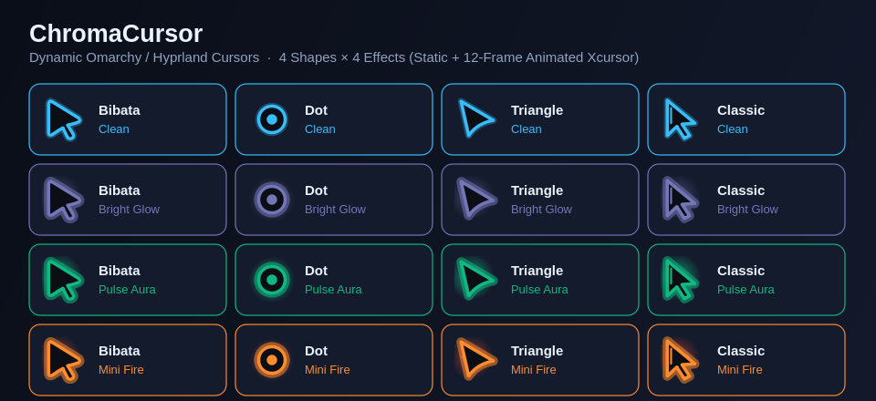

# ChromaCursor

**Dynamic Linux Xcursor theme that automatically recolors itself every time you switch your Omarchy / Hyprland theme!**



Zero `xcursorgen` required — **ChromaCursor** renders crisp multi-size (`24px`, `32px`, `48px`) anti-aliased vector cursors (including 12-frame animated **Pulse Aura**, **Mini Fire 🔥**, and **Wait** spinner cursors) directly into native Xcursor binaries (`Xcur`) in pure Python + Qt 6 (`PySide6`), and hot-reloads Hyprland + GTK live with **no logout required**.

## Features

- **Automatic Omarchy Theme Sync:** Installs an official Omarchy `theme-set` hook (`~/.config/omarchy/hooks/theme-set.d/chromacursor`). Switch your Omarchy theme → your cursor automatically adapts to the new accent & surface colors in under 0.4s!
- **4 Cursor Shapes × 3 Color Styles × 4 Effects (including native animated Xcursors!):**
  - **Shapes:** **Bibata**, **Dot**, **Triangle**, and **Classic**
  - **Effects:** **Clean**, **Bright Glow**, **Pulse Aura** *(12-frame animated breathing glow)*, and **Mini Fire 🔥** *(12-frame animated ember glow + rising micro-sparks)*
  - **Color Styles:** **Neon Outline**, **Solid Accent**, and **Minimal Glass**
- **Complete Cursor Set:** `default`, `pointer`, `text`, `crosshair`, `move`, `ew-resize`, `ns-resize`, `nwse-resize`, `nesw-resize`, `not-allowed`, and a **12-frame animated `wait` / `progress`** spinner + all standard Wayland/X11/GTK/Qt symlinks.
- **Companion Qt 6 Studio GUI:** Live preview of all cursors, 1-click style & size switcher (`24 / 32 / 48px`), Auto-Sync Hook toggle, and 1-click **Restore Bibata** button.

## Quick Install (Arch / Omarchy / Hyprland)

```bash
git clone https://github.com/ilievi187/chromacursor.git
cd chromacursor
./install.sh
```

Or run the CLI directly:

```bash
python3 generator.py --style neon --size 24
python3 generator.py --style solid --accent "#38bdf8"
python3 generator.py --restore
```

## Support

If ChromaCursor makes your desktop cleaner, you can support development at [buymeacoffee.com/aurorauap](https://buymeacoffee.com/aurorauap).
